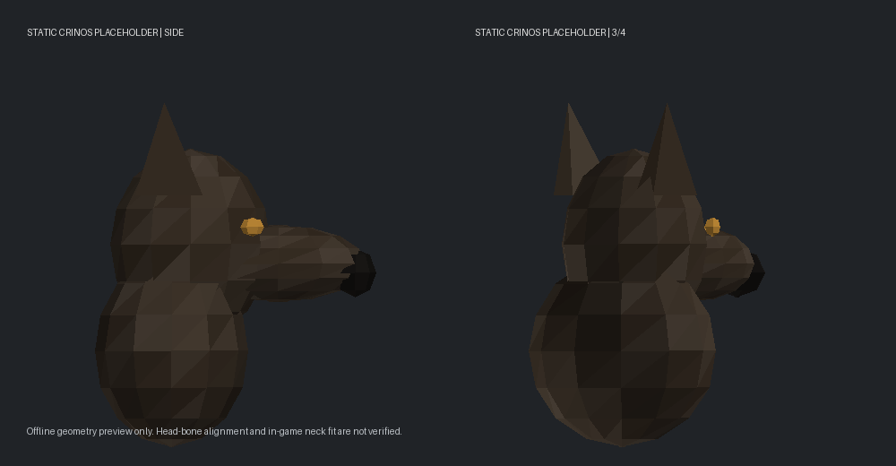

# Werewolf: Outbreak 0.4.30: Crinos cosmetics prototype

This is an implemented test scaffold, not finished werewolf art or a verified
in-game fit. It keeps the vanilla male/female player mesh, human skeleton,
human animation graph and current Crinos scale. No tail or digitigrade changes
are included.

## What is implemented

- A replaceable static head-and-thick-neck-cuff GLB follows `Bip01_Head`.
  It is added to the native model slot, not equipped, spawned or saved as an item.
- The native body compositor masks the human head region once the replacement
  has been attached. Hair/beard model population is skipped for that slot only.
  The neck is covered by the cuff, not surgically removed from the human mesh.
- The body compositor uses a coat-matched, fully opaque fur texture instead of
  the underlying human skin texture. This replaces painted-on briefs as well.
  Actual worn underwear is still clothing; this does NOT secretly unequip or
  delete inventory items or globally bypass their clothing layers.
- The normal clothing compositor is retained, including body-region masks,
  blood and dirt. This is not a final render texture override that paints over
  clothing. Saved skin, hairstyle, beard, gender and clothing state are untouched.
- Original and Blonde have separate matching body/head textures. The existing
  authoritative coat selection and remote visual snapshots select the pair.
- All gameplay stats, shift rules, animations, weapon attachments, wolf visuals,
  cargo scaling and existing clothes-tearing rules remain as before.

The design uses native static bone attachment and texture-mask mechanisms.
The general distinction between static and skinned accessories is described in
[the PZ modeling guide](https://theindiestone.com/forums/topic/37647-the-one-stop-shop-for-3d-modeling-from-blender-to-zomboid/).
That older guide is background, not proof of current API compatibility: the
actual hooks/signatures were checked against the privately supplied 42.21 JAR.

## Replace the placeholder in Blender

Runtime asset, relative to `WTAGarou/`:

```text
common/media/models_X/WTAGarou/WTAGarou_CrinosHead.glb
```

Import this GLB and edit/replace its geometry, preserving its origin, axes and
size. It contains one original low-poly mesh with a skull, muzzle, ears and
thick closed collar. No third-party head geometry was copied.



This is a STATIC, head-bone-local template, not a human rest-pose armature:

- `+X` runs up the head, `+Y` points along the muzzle, `Z` runs side-to-side.
- The origin is the head-bone mount; the collar extends below it.
- Keep transforms applied consistently. Export only the replacement mesh.
- Preserve the path/name. No animations, extra armature or IK solver are needed.
- Runtime uses the external PNG selected by the coat registry, not the GLB's
  embedded preview material. Keep one material/UV atlas for this first version.
- Most of the head atlas is fur; the bottom strip has dark nose, pale and amber
  swatches. Repaint/re-UV both coat atlases if you need detailed facial markings.

In `42/media/scripts/wtagarou_models.txt`, `model WTAGarou_CrinosHead` controls
the mesh path and uniform scale. Its `attachment mount` holds rotation/offset
calibration. This is a SELF attachment: the native engine inverts its transform.
Start with zero transforms; inspect standing, aiming and crouching before
changing them. The dimensions and bone alignment still need a game test.

A full restart is recommended after changing GLB/script/PNG assets. The Java
JAR does not need rebuilding merely to replace this same-path static GLB.
Do not rerun the generator's default command after sculpting: it overwrites
the placeholder GLB and default texture pairs.

## Coat matching without stretching wolf UVs

The body is not mapped to the wolf atlas. Instead, the offline generator samples
the central torso patch (40%-60% of both axes), rejects transparent/near-black
padding, takes a median RGB, and builds a subtle fur-grain swatch.

The current sampled colors are Original `64,54,44` and Blonde `153,133,108`.
These are dark torso-fur samples, not averages of the entire coat or an artistic
promise of the ideal color. Lighter belly fur and facial markings are not
automatically transferred. Edit the output PNGs to taste.

The new body swatch covers the whole human texture sheet, so it does not need
wolf and human UV islands to correspond. It is intentionally plain: an authored
human-UV fur texture will give better anatomy, belly markings and seam control.
The same simple swatch currently serves male and female meshes.

Current outputs:

```text
common/media/textures/Body/WTAGarou_CrinosBody_Default.png
common/media/textures/Body/WTAGarou_CrinosHead_Default.png
common/media/textures/Body/WTAGarou_CrinosBody_Blonde.png
common/media/textures/Body/WTAGarou_CrinosHead_Blonde.png
```

For another coat, generate only its textures without overwriting the GLB:

```bash
python tools/build_crinos_placeholder.py --coat common/media/textures/Body/WTAGarou_Wolf_Brown.png Brown
```

Requires Python, Pillow and numpy. Add these fields to its existing entry in
`42/media/lua/shared/WTAGarouWolfCoats.lua`:

```lua
crinosBody = "WTAGarou_CrinosBody_Brown",
crinosHead = "WTAGarou_CrinosHead_Brown",
```

Without these fields, a new wolf coat explicitly uses the Original Crinos pair.
There is no runtime directory scan or every-frame PNG sampling.

## Neck, legs and clothing: recommended next stages

The current rigid cuff follows the head. It will not smoothly deform into the
shoulders and may clip during deep crouches, extreme head turns or aiming.
This is the quickest placeholder route, not equivalent to a weighted neck.

For the final thick neck, use a skinned head/neck mesh with weights blending
between the ACTUAL native upper-spine, neck and head bones. Use the game rig's
real names and bind poses, not an independently guessed armature. It can then
share human animation poses without authoring a full Crinos animation library.
The runtime loader would change from static attachment to native additional
skinned model. The current static GLB should not simply be exported with a new
skeleton and dropped into this static path.

For that stage, useful private reference files from the local game installation
are the male/female player body meshes under `media/models_X/Skinned` (including
their actual extensions) and relevant `media/textures/Body` textures/masks.
The previously supplied ZIP contained JAR/launcher files, not those meshes.
Keep proprietary reference assets private and out of the distributable mod.

Digitigrade choices, in recommended order:

- First test sculpted calf/foot overlays weighted to the existing human bones.
  This can suggest a raised heel/hock without changing the skeleton, but the
  motion and footprint still follow human animation.
- True changed leg proportions need mesh/rig work and pose correction, possibly
  IK/retargeting. IK does not automatically refit trousers or shoes, and changing
  bone poses also affects their skinned geometry and contacts with chairs/stairs.
- Keep human hand/weapon/back/belt bones unchanged to preserve those attachments.
  Clothing fit is a separate problem from retaining attachment compatibility.
- Expect trousers, boots and long coats to need custom variants, selective visual
  hiding, or accepted clipping. Do not build a universal clothing-retargeter yet.

Recommendation: finish head/neck and body fur first. Leave the tail absent as
requested, then decide if digitigrade silhouette is worth another compatibility
workstream after seeing the form at normal gameplay zoom.

## Safety and verification

`WTAGarou.EnableCrinosCosmetics = false` in Definitions disables the prototype.
Reload definitions/refresh the form to rebuild the normal human appearance.
The Java API receives already-resolved authoritative form/coat data from the
existing local/remote visual path. It does not create new gameplay commands.

Assets are preflighted before activating. Missing/pending assets retain the
human appearance; Lua retries once a second for at most 60 attempts. If a head
bone cannot be found, native hair and body texture remain rather than deliberately
making a headless character. Restart/reload can retry.

Model-instance pool reset clears the body-role marker. Appearance rebuilds use
native model-slot ownership. No globally shared mesh/texture/skin definition is
edited, and no persistent human appearance backup needs to be restored.

Automated checks:

- Lua routing, coat fallback, kill switch and bounded asynchronous retries.
- Real ZombieBuddy-translated advice applied to fixtures for head mounting,
  ownership, hair suppression, compositor masking, texture selection, unaffected
  humans, missing-bone fallback and pooled instance cleanup.
- GLB structure, finite vertices/normals, UV range, small bounds and opaque PNGs.
- Existing complete Lua and Java regression suites.
- Offline weave audit against supplied PZ 42.21: all 28 patches resolve, including
  the three new cosmetic hooks. This is not a game boot or rendering test.

Next playtest: Original/Blonde Crinos; human -> Crinos -> wolf -> human; save/load;
male/female; outfit changes; blood; aiming/crouching; multiplayer observer if
available. Check orientation, scale, head masking, neck seam, underwear source,
restored human hair/skin and unchanged gear placement. No live visual or
multiplayer result is claimed.
